<div align="center">

# Task Management

**Plan the work. See the progress.**

A web app where a team plans projects, organizes tasks, and tracks progress in one workspace.<br>
Built with Next.js and Express, and set up on AWS with Terraform.


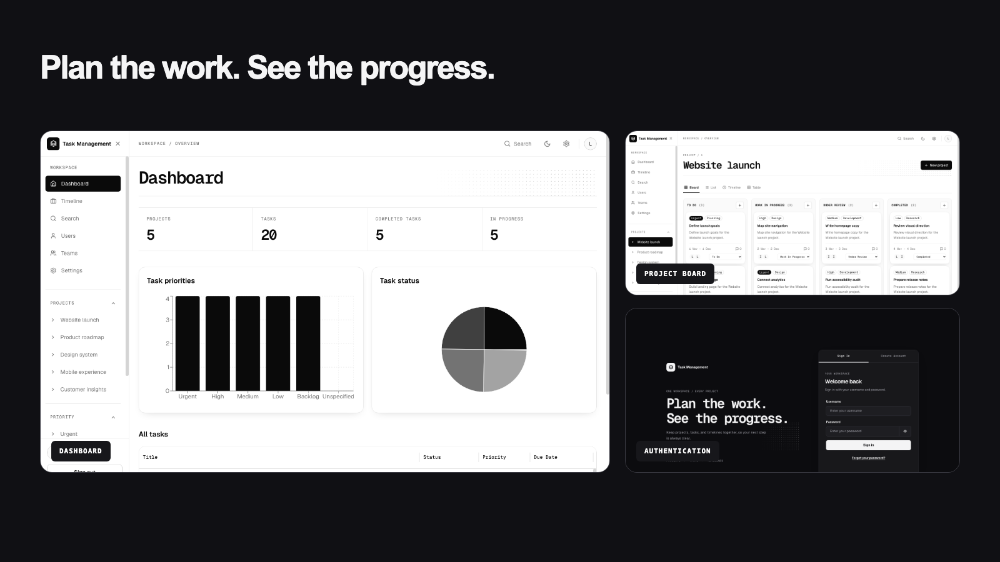

[Features](#features) · [Screenshots](#screenshots) · [Tech Stack](#tech-stack) · [Architecture](#architecture) · [Getting Started](#getting-started) · [Status](#project-status) · [Roadmap](#roadmap)

</div>

---

## About

Task Management gives a team one place to see every project, who is working on what, and how close each piece of work is to done.

- **One workspace** for projects, tasks, teams, and timelines.
- **Progress at a glance** through dashboards, charts, and Gantt timelines.
- **Four views of the same work**: board, list, table, and timeline.
- **Secure accounts** with email-confirmed sign-up through Amazon Cognito.
- **Infrastructure as code**: every AWS resource is defined in Terraform.

## Features

| Module             | What it does                                                                            |
| ------------------ | --------------------------------------------------------------------------------------- |
| **Authentication** | Sign-up with email confirmation, sign-in, and password reset (Cognito)                  |
| **Dashboard**      | Project and task totals, priority and status charts, and a task table                   |
| **Projects**       | Board, list, table, and timeline views of each project's tasks                          |
| **Tasks**          | Create tasks and drag them between To Do, Work In Progress, Under Review, and Completed |
| **Timeline**       | Gantt chart of every project on a day, week, or month scale                             |
| **Priority Views** | The signed-in user's Urgent, High, Medium, Low, and Backlog tasks                       |
| **Search**         | Find tasks, projects, and users by keyword                                              |
| **Users & Teams**  | Member directory and each team's product owner and project manager                      |
| **Settings**       | Account details and a System, Light, or Dark theme                                      |

## Screenshots

<table>
  <tr>
    <td width="50%" align="center">
      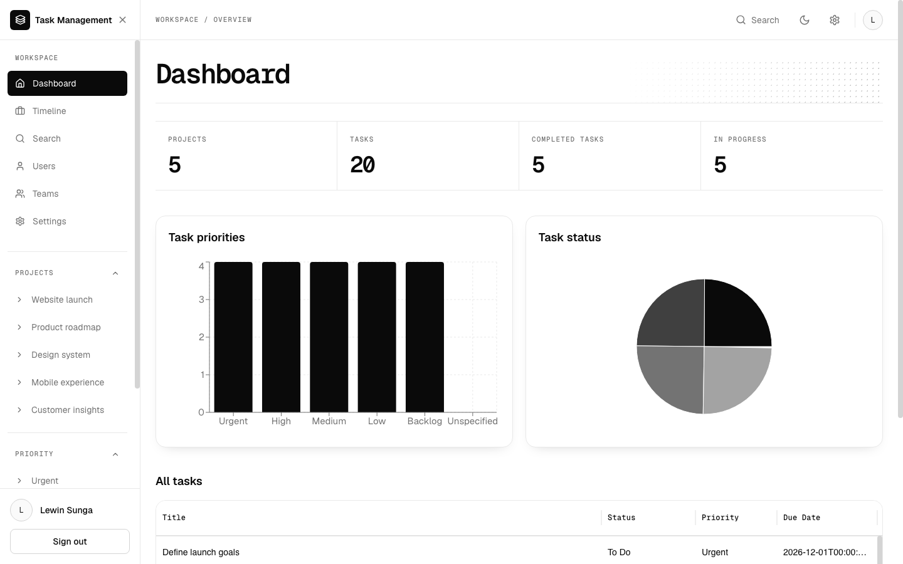<br>
      <sub><b>Dashboard</b></sub>
    </td>
    <td width="50%" align="center">
      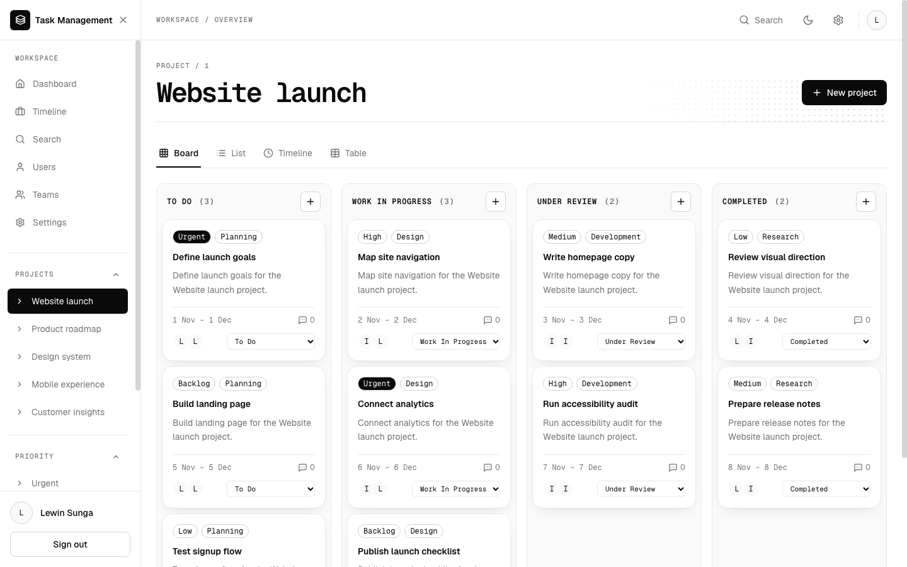<br>
      <sub><b>Project board</b></sub>
    </td>
  </tr>
  <tr>
    <td width="50%" align="center">
      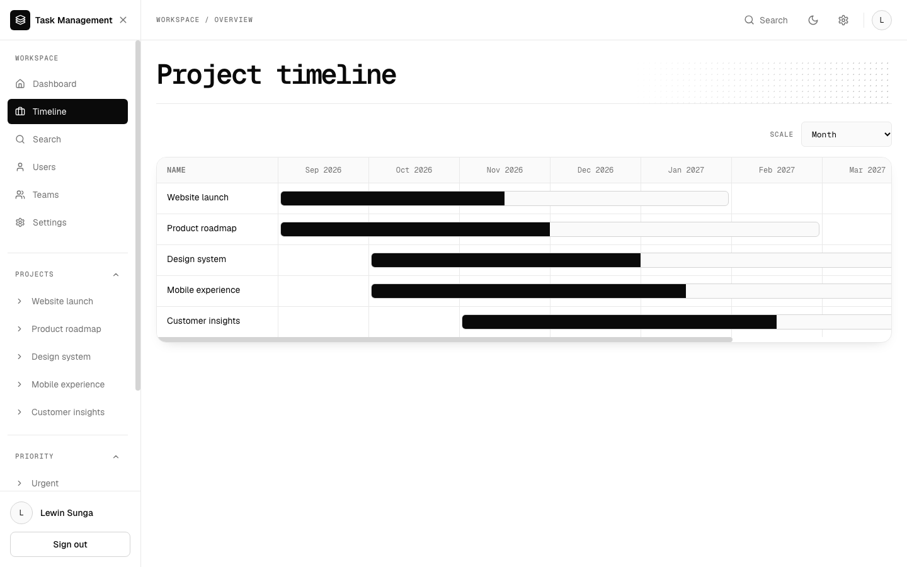<br>
      <sub><b>Timeline</b></sub>
    </td>
    <td width="50%" align="center">
      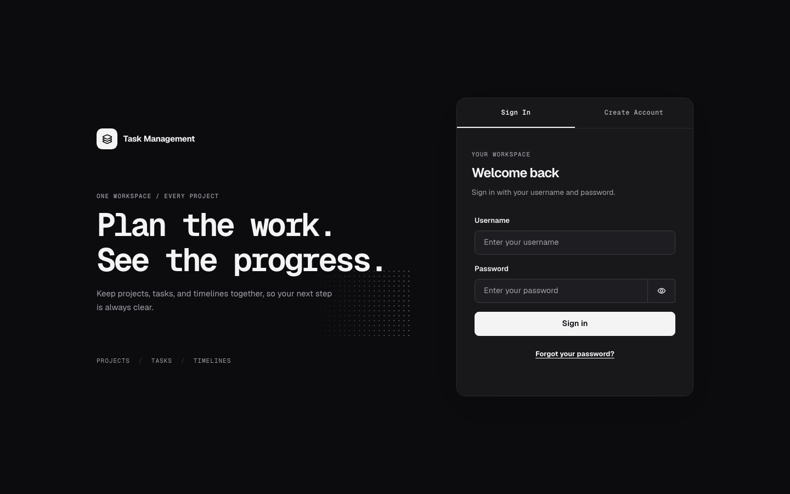<br>
      <sub><b>Sign in</b></sub>
    </td>
  </tr>
</table>

<details>
<summary><b>More screenshots</b></summary>
<br>

<table>
  <tr>
    <td width="50%" align="center">
      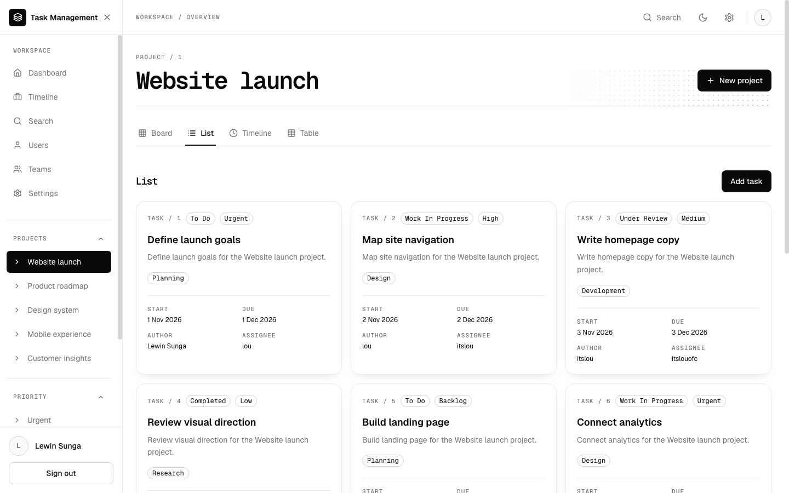<br>
      <sub><b>Project list</b></sub>
    </td>
    <td width="50%" align="center">
      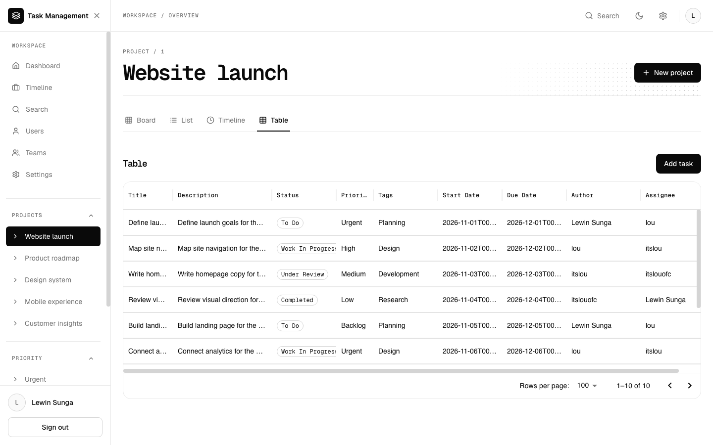<br>
      <sub><b>Project table</b></sub>
    </td>
  </tr>
  <tr>
    <td width="50%" align="center">
      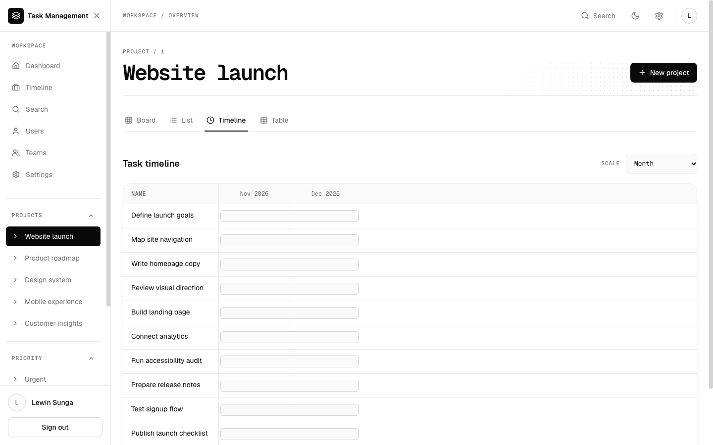<br>
      <sub><b>Project timeline</b></sub>
    </td>
    <td width="50%" align="center">
      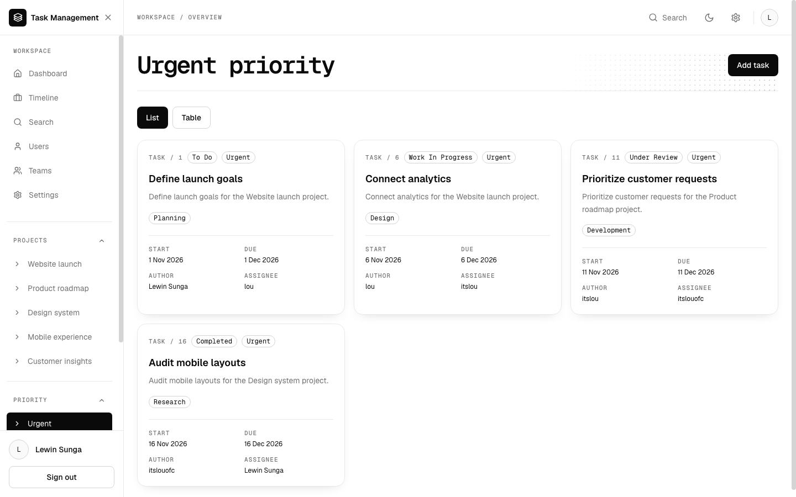<br>
      <sub><b>Priority view</b></sub>
    </td>
  </tr>
  <tr>
    <td width="50%" align="center">
      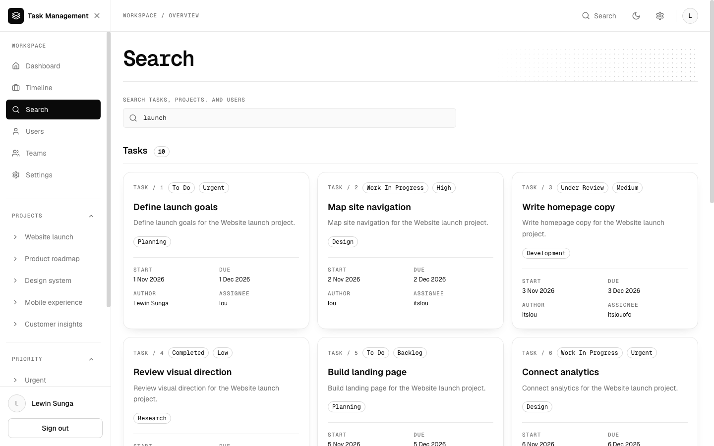<br>
      <sub><b>Search</b></sub>
    </td>
    <td width="50%" align="center">
      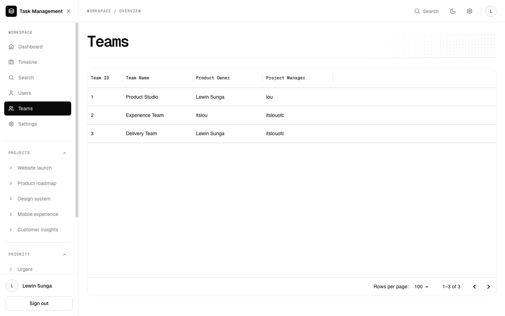<br>
      <sub><b>Teams</b></sub>
    </td>
  </tr>
  <tr>
    <td width="50%" align="center">
      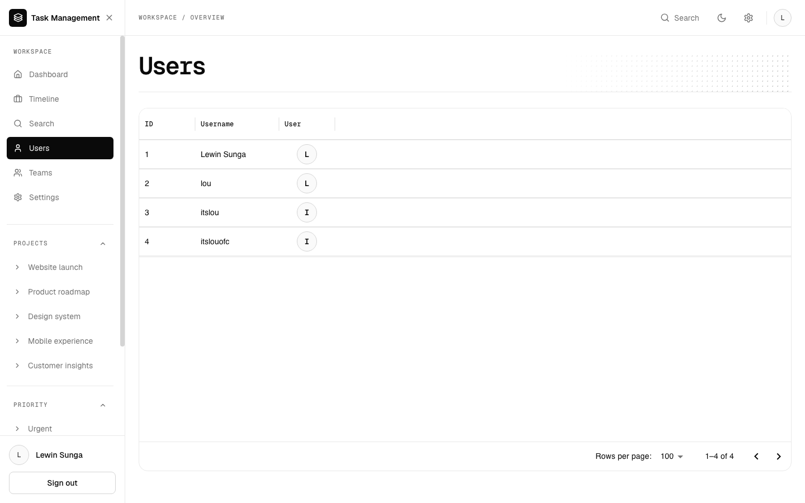<br>
      <sub><b>Users</b></sub>
    </td>
    <td width="50%" align="center">
      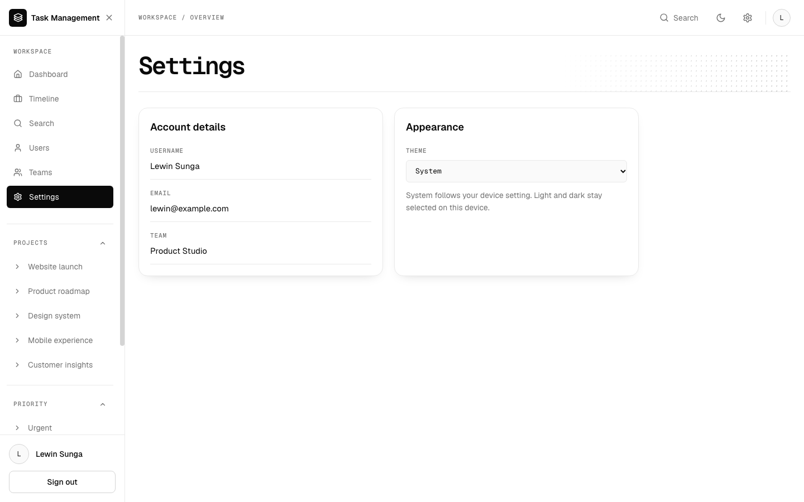<br>
      <sub><b>Settings</b></sub>
    </td>
  </tr>
  <tr>
    <td width="50%" align="center">
      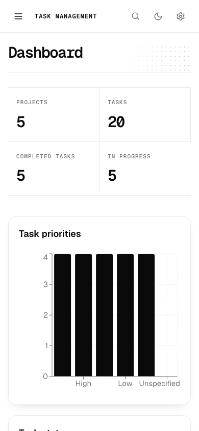<br>
      <sub><b>Dashboard on mobile</b></sub>
    </td>
    <td width="50%" align="center">
      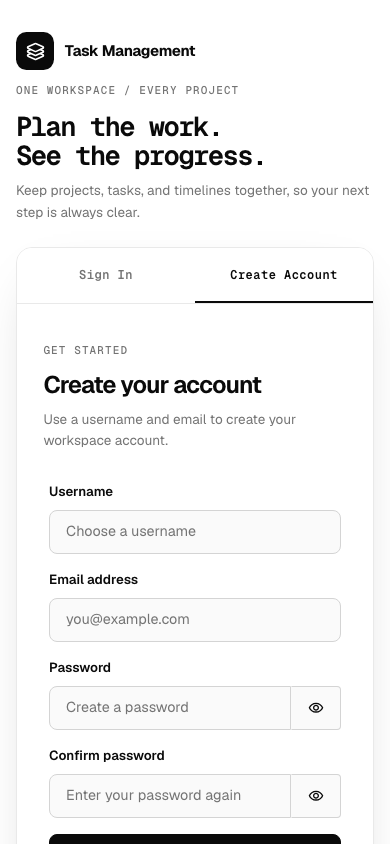<br>
      <sub><b>Sign up on mobile</b></sub>
    </td>
  </tr>
</table>

</details>

## Tech Stack

| Layer              | Technology                                                                                        |
| ------------------ | ------------------------------------------------------------------------------------------------- |
| **Frontend**       | Next.js 16 (App Router), React 19, TypeScript, Tailwind CSS, Redux Toolkit Query, Recharts        |
| **Backend**        | Node.js, Express 5, TypeScript                                                                    |
| **Database**       | PostgreSQL with Prisma 7                                                   |
| **Infrastructure** | Terraform, AWS Amplify, API Gateway, EC2, RDS, Lambda, Cognito, S3                                |

## Architecture

The browser loads the Next.js app from Amplify, then sends its data requests to the API:

```text
Browser ──▶ API Gateway ──▶ EC2 (Express API) ──▶ RDS (PostgreSQL)
```

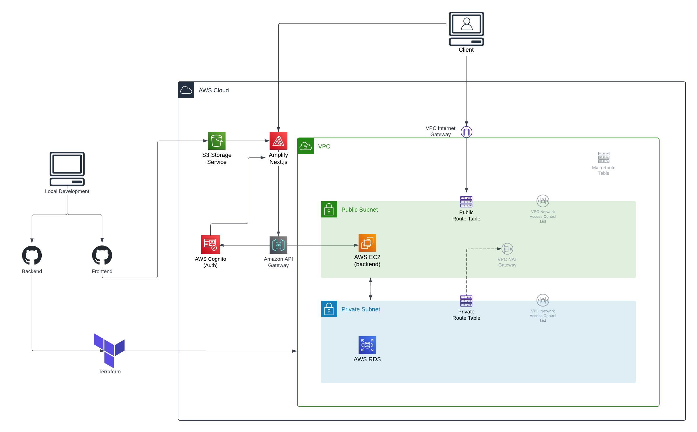

1. **Code to cloud:** Developers work locally and push the frontend and backend to GitHub. Terraform creates the AWS resources.
2. **Frontend:** Amplify builds and hosts the Next.js app. Terraform also creates an S3 bucket for the app's images, though the client still loads them from a hard-coded address.
3. **Sign-in:** Cognito manages accounts. After a user confirms sign-up, a Lambda function (not drawn in the diagram) adds them to the database.
4. **API:** API Gateway checks the Cognito token on each request and forwards it to the Express API on EC2. The one exception is `POST /users`, which the sign-up Lambda calls before the user has a token.
5. **Network:** EC2 runs in a public subnet behind the internet gateway. RDS runs in private subnets that only EC2 can reach.

### How it works

1. A user creates an account and confirms it with the code sent by email.
2. The system adds the new user to the database.
3. The user signs in and lands on the dashboard.
4. The user creates a project and adds tasks with priorities, dates, and assignees.
5. Team members move tasks through To Do, Work In Progress, Under Review, and Completed.
6. Everyone tracks progress through the dashboard, timeline, priority views, and search.

## Getting Started

### Prerequisites

- Node.js 20.19 or newer
- PostgreSQL
- A Cognito user pool in AWS or LocalStack
- Terraform 1.11 or newer, only for deploying

### 1. Install dependencies

```bash
cd client && npm install
cd ../server && npm install
```

### 2. Configure environment variables

Copy each example file and fill in the values.

| File                | Copy from             | Variables                                                                                                                                                                          |
| ------------------- | --------------------- | ---------------------------------------------------------------------------------------------------------------------------------------------------------------------------------- |
| `server/.env`       | `server/.env.example` | `PORT`, `DATABASE_URL`                                                                                                                                                             |
| `client/.env.local` | `client/.env.example` | `NEXT_PUBLIC_API_BASE_URL`, `NEXT_PUBLIC_COGNITO_USER_POOL_ID`, `NEXT_PUBLIC_COGNITO_USER_POOL_CLIENT_ID`, `NEXT_PUBLIC_COGNITO_USER_POOL_ENDPOINT`, `COGNITO_LOCALSTACK_ENDPOINT` |

> [!NOTE]
> Values that start with `NEXT_PUBLIC_` are visible in the browser. Keep passwords and AWS keys out of both files.

### 3. Set up the database and start the API

```bash
cd server
npx prisma generate
npx prisma migrate dev
npm run dev
```

### 4. Start the web app

In a second terminal, then open [http://localhost:3000](http://localhost:3000):

```bash
cd client
npm run dev
```

### Sample data (optional)

```bash
cd server
npm run seed
```

> [!WARNING]
> Seeding deletes every existing row before loading the sample data. Run it only on a local database.

<details>
<summary><b>Reset the ID counters after seeding</b></summary>
<br>

The sample data uses fixed IDs, so PostgreSQL's ID counters fall behind and creating a record fails until you reset them. Run this in PgAdmin or `psql` for each seeded table: `Project`, `ProjectTeam`, `Task`, `TaskAssignment`, `Attachment`, and `Comment`.

```sql
SELECT setval(pg_get_serial_sequence('"Project"', 'id'), coalesce(max(id)+1, 1), false) FROM "Project";
```

</details>

### Deploy to AWS

Follow [terraform/README.md](terraform/README.md), then set up the API server with [server/aws-ec2-instructions.md](server/aws-ec2-instructions.md).

## Project Structure

```text
project-management/
├── client/                   # Next.js web app
│   └── src/
│       ├── app/              # Pages, layouts, and the LocalStack Cognito proxy
│       ├── components/       # Reusable UI components
│       ├── lib/              # Shared utilities and branding
│       └── state/            # Redux store and API requests
├── server/                   # Express API
│   ├── prisma/               # Database schema, migrations, and seed data
│   └── src/
│       ├── controllers/      # Request handlers
│       └── routes/           # URL mappings
├── terraform/                # AWS infrastructure and the sign-up Lambda
├── docs/screenshots/         # UI screenshots
├── TaskManagement.png        # Cloud architecture diagram
├── SYSTEM_OVERVIEW.md        # Short technical overview
├── CODING_STANDARDS.md       # Code conventions
└── README.md                 # Project introduction
```

## Project Status

| Stage           | Details                                                                                                                 |
| --------------- | ----------------------------------------------------------------------------------------------------------------------- |
| **Completed**   | Dashboard, project views, timeline, priority views, search, users and teams, settings, Cognito sign-in, Terraform setup |
| **In progress** | Deploying to AWS. The Terraform configuration is validated but not yet applied.                                         |

**Known issues**

- The Express API does not verify access tokens yet, so requests sent straight to the EC2 address skip the Cognito check.
- Task images load from a hard-coded S3 address that belongs to another account.
- Locally, nothing adds a new user to the database after sign-up. Create the row with `POST /users`.
- Seeding deletes existing rows and requires the ID reset above.

